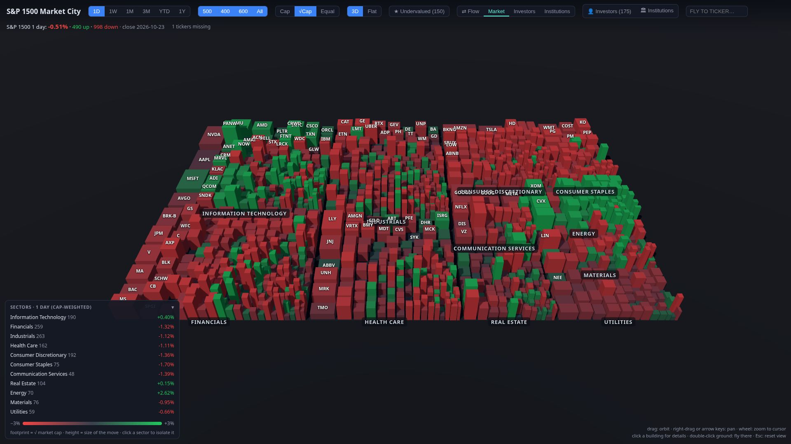
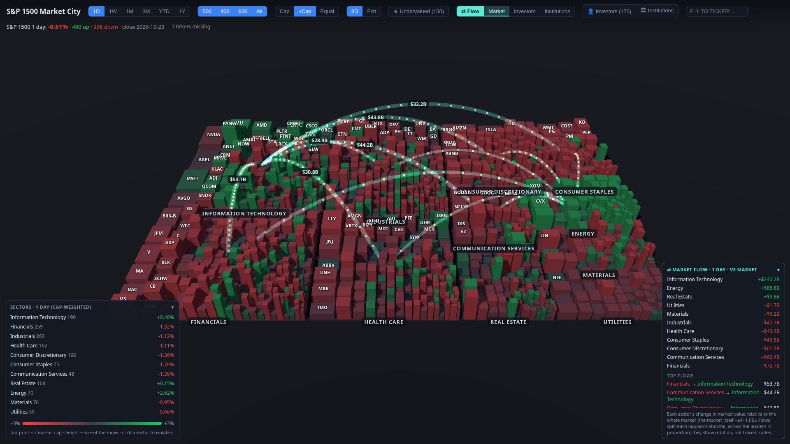
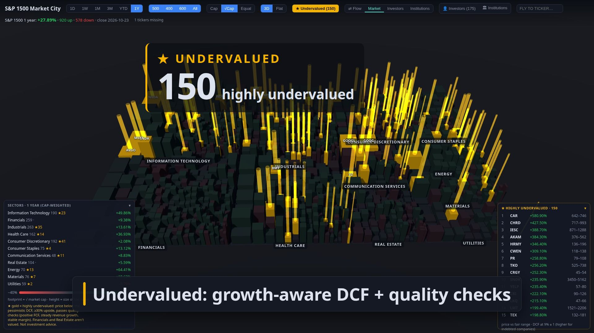
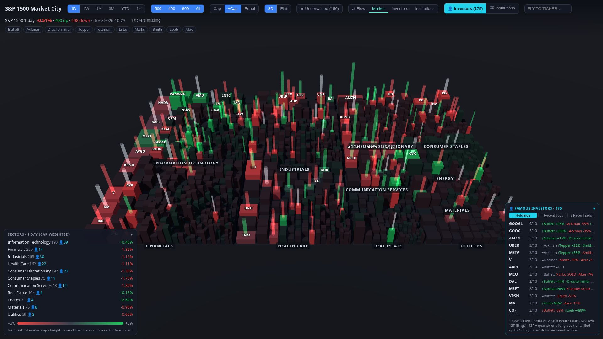
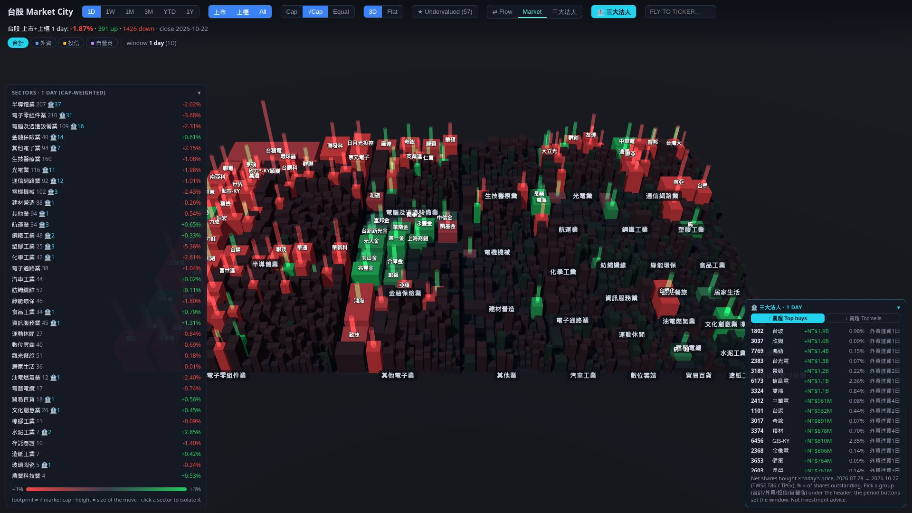
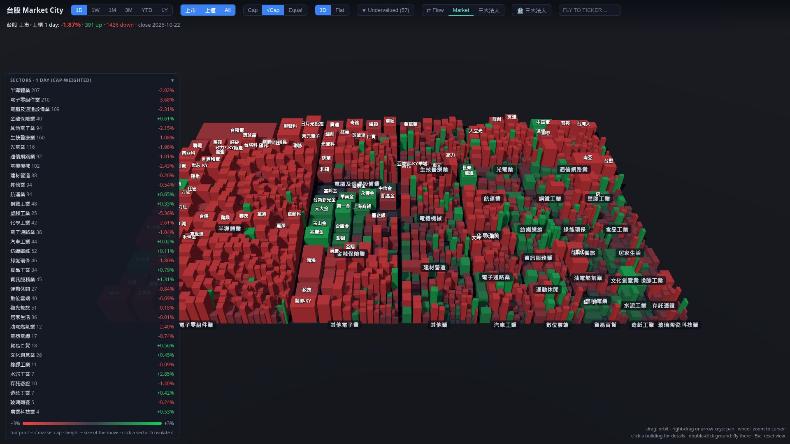

# Stock Market City

**See the whole stock market as a 3D city.** Every company is a building. Its footprint is its market cap, its
height is how far it moved, and its color shows whether it went up or down. Sectors are districts, so you can
spot a tech sell-off or an energy rally at a glance, then fly in to any single stock.

There are two cities: the **US S&P 1500** (about 1,500 stocks) and **Taiwan TWSE + TPEx** (about 2,000 stocks).



## Videos

**S&P 1500 Market City** · [watch / download](docs/videos/us-market-city.mp4)

<video src="docs/videos/us-market-city.mp4" controls width="100%"></video>

**台股 Market City** · [watch / download](docs/videos/tw-market-city.mp4)

<video src="docs/videos/tw-market-city.mp4" controls width="100%"></video>

## What you can do

| | |
|---|---|
|  |  |
| **⇄ Sector flow**: animated arcs show money rotating from losing sectors into gaining ones, using market moves, famous investors' trades or giant institutions' buying. | **★ Undervalued**: a growth-aware DCF with quality checks marks the highly undervalued stocks as glowing gold towers. |
|  |  |
| **👤 Famous investors and 🏛 institutions**: SEC 13F filings from Buffett, Ackman, Druckenmiller and others show what they bought and sold. | **🏦 三大法人**: Taiwan's daily net buying by foreign investors, investment trusts and dealers, with buy/sell streaks. |

You can also:

- Switch the period between **1D, 1W, 1M, 3M, YTD and 1Y**, and the buildings animate to the new returns.
- Size buildings by **market cap, √cap or equally**, and view the city in **3D or as a flat heat map**.
- Click a sector to isolate it, click a building for a 1-year chart, or type a ticker to fly to it.



## Quick start

You only need Python 3. The servers use the standard library alone, and the page loads three.js from a CDN.

| Folder | Market | Run | Open |
|---|---|---|---|
| [`us/`](us/README.md) | S&P 1500 (S&P 500 + 400 + 600) with valuation, famous investors, giant institutions (SEC 13F) and sector flow | `cd us && python3 server.py --sec-agent "Your Name you@example.com"` | http://127.0.0.1:8000 |
| [`twse/`](twse/README.md) | Taiwan: TWSE 上市 + TPEx 上櫃 with valuation, 月營收, 三大法人 and sector flow | `cd twse && python3 server.py` | http://127.0.0.1:8001 |

The first start downloads market data and can take several minutes; the page shows a progress bar and fills in
as data arrives. After that everything loads from the cache in each folder's `data/`. Both cities can run at the
same time. The SEC asks for a contact name and email in the User-Agent, which is why the US server takes
`--sec-agent`; without it, the city still works but the 13F investor views stay off.

See [us/README.md](us/README.md) and [twse/README.md](twse/README.md) for every view, data source and how the
valuation works.

## Making the videos

The videos are rendered with [Remotion](https://www.remotion.dev/) from footage of the running cities. With both
servers running:

```bash
cd video
npm install
node capture/shots.mjs us   # record footage into public/footage/ (needs Google Chrome)
node capture/shots.mjs tw
npm run render:us           # out/us-market-city.mp4
npm run render:tw           # out/tw-market-city.mp4
```

The finished videos are in `docs/videos/`, but the footage and music are not in the repo, so you need to capture your own footage and add your
own audio to `public/audio/`.

## Disclaimer

This is a visualization project, not investment advice. Data comes from public sources (Yahoo Finance, SEC
EDGAR, TWSE and TPEx OpenAPI) and may be delayed or incomplete.
